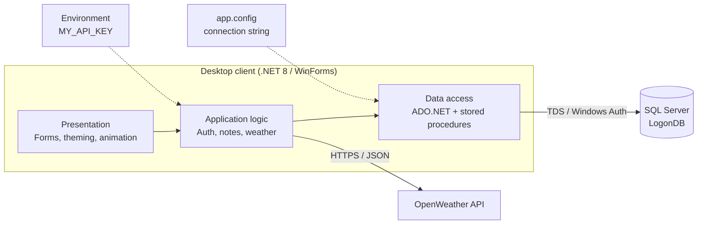
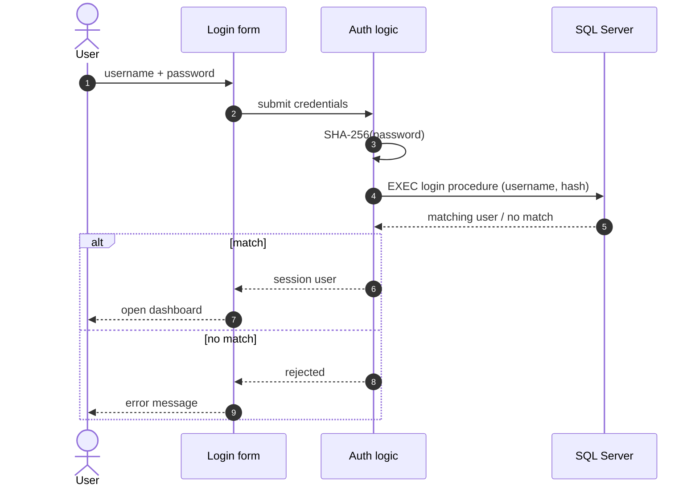
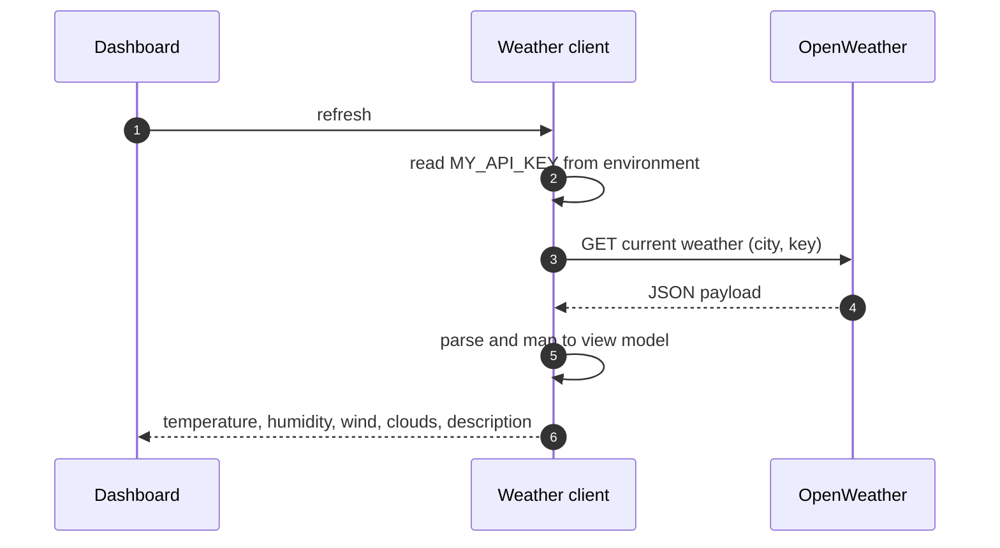
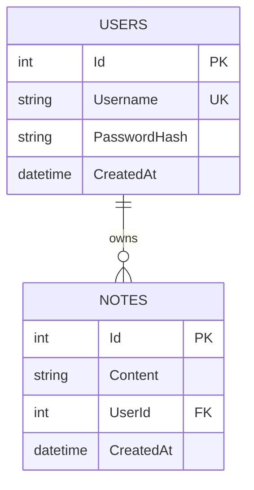

<div align="center">



<a href="https://github.com/MIhajloS07/Logon-desktop-App">
  
</a>

<br>


[Overview](#overview) ·
[Screenshots](#screenshots) ·
[Architecture](#architecture) ·
[Data model](#data-model) ·
[Getting started](#getting-started) ·
[Security](#security-model) ·
[Roadmap](#roadmap)

</div>

---

## Overview

Logon APP is a Windows desktop application written in C# on .NET 8 (WinForms). It was built for a tech shop in the municipality of Lebane, Serbia, as an internal tool that combines an authenticated workspace with a few operational utilities: personal notes, a live weather panel for the shop's location, and a clock.

The scope is intentionally narrow and the boundaries are explicit:

- **Identity** is handled by the application itself (registration, login, password hashing).
- **Persistence** is handled by SQL Server. All data access goes through ADO.NET and stored procedures; the UI never builds SQL.
- **External data** comes from a single third-party dependency, the OpenWeather API, consumed over HTTPS as JSON.
- **Configuration** is external to the code: the connection string lives in `app.config`, the API key in an environment variable. Nothing sensitive is committed.

Adapting it to a different site requires only two changes: the connection string and the API key (plus the target city for the weather panel).

---

## Screenshots

<table>
  <tr>
    <td align="center" width="50%">
      
      <br><sub><b>Login</b></sub>
    </td>
    <td align="center" width="50%">
      
      <br><sub><b>Registration</b></sub>
    </td>
  </tr>
  <tr>
    <td align="center" width="50%">
      
      <br><sub><b>Dashboard: notes, weather, clock</b></sub>
    </td>
    <td align="center" width="50%">
      
      <br><sub><b>Dashboard: alternate theme</b></sub>
    </td>
  </tr>
</table>

---

## Features

| Module | Behaviour |
| :-- | :-- |
| **Authentication** | Registration and login against the `Users` table. Passwords are never stored in plain text; only the SHA-256 digest is persisted. Usernames are unique. |
| **Notes** | Full CRUD on notes scoped to the signed-in user. Each note belongs to exactly one user through a foreign key. |
| **Weather panel** | Current conditions for Lebane from the OpenWeather API: temperature, feels-like, humidity, wind speed, cloud coverage and a textual description. |
| **Theming** | Three themes (Default, Light, Dark) switchable at runtime without restarting the application. |
| **Clock and date** | Continuously updated time and date in the main window. |
| **Animated logo** | Lightweight logo animation on the entry screen. |
| **Data access** | Every read and write is a stored procedure call through ADO.NET. |

---

## Architecture

The application follows a straightforward layered structure. The diagram is the logical view; the layers are conceptual boundaries rather than separate assemblies.



### Sign-in flow



### Weather refresh



---

## Data model



One user owns many notes. The foreign key from `Notes.UserId` to `Users.Id` guarantees that no note can exist without an owner.

---

## Tech stack

| Layer | Technology |
| :-- | :-- |
| Language | C# |
| Runtime | .NET 8 |
| UI | Windows Forms |
| Database | Microsoft SQL Server (T-SQL, stored procedures) |
| Data access | ADO.NET |
| External API | OpenWeather (REST, JSON) |
| Tooling | Visual Studio, SSMS, Git |

---

## Getting started

### Prerequisites

| Requirement | Notes |
| :-- | :-- |
| Windows 10 / 11 | WinForms is Windows-only |
| .NET 8 SDK | `dotnet --version` should report `8.x` |
| Visual Studio 2022 | With the *.NET desktop development* workload |
| SQL Server | Express edition is sufficient |
| SSMS | Or any client able to run a `.sql` script |
| OpenWeather API key | Free tier is enough |

### 1. Clone

```bash
git clone https://github.com/MIhajloS07/Logon-desktop-App.git
cd Logon-desktop-App
```

### 2. Create the database

Open SQL Server Management Studio, connect to your instance and execute:

```
Database/DatabaseSetup.sql
```

The script creates `LogonDB` with the `Users` and `Notes` tables, the constraints between them and the stored procedures used by the application.

### 3. Configure the connection string

In `app.config`, point the connection string at your instance:

```xml
<connectionStrings>
  <add name="LogonDB"
       connectionString="Data Source=LOCALHOST\SQLEXPRESS;Initial Catalog=LogonDB;Integrated Security=True;"
       providerName="System.Data.SqlClient" />
</connectionStrings>
```

`Integrated Security=True` means Windows Authentication. No SQL login or password is stored anywhere in the project.

### 4. Provide the OpenWeather API key

Create a key at <https://openweathermap.org/api>, then store it as a user-level environment variable:

```powershell
setx MY_API_KEY "your_api_key_here"
```

> [!IMPORTANT]
> `setx` only affects processes started afterwards. Close and reopen Visual Studio before running the application, otherwise the key will not be visible.

### 5. Build and run

Open `LOGON APP.sln` in Visual Studio, set the project as startup and press `F5`.

Or from a terminal:

```bash
dotnet run --project "LOGON APP"
```

### Configuration reference

| Setting | Location | Purpose |
| :-- | :-- | :-- |
| `LogonDB` connection string | `app.config` | SQL Server instance and database |
| `MY_API_KEY` | Environment variable | OpenWeather authentication |

<details>
<summary><b>Troubleshooting</b></summary>

<br>

| Symptom | Likely cause | Fix |
| :-- | :-- | :-- |
| Cannot open database `LogonDB` | Setup script was not executed, or wrong instance name | Run `DatabaseSetup.sql`; verify `Data Source` against the instance shown in SSMS |
| Login failed for the Windows user | The account has no access to the instance | Grant the account a login on the instance with access to `LogonDB` |
| Weather panel is empty or shows an error | `MY_API_KEY` is missing or not yet visible to the process | Restart Visual Studio after `setx`; confirm the key is active on the OpenWeather dashboard (new keys can take a while to activate) |
| `401` from the weather API | Invalid or not yet activated key | Check the key and wait for activation |
| Network error on weather refresh | No outbound HTTPS access | Check firewall / proxy settings |

</details>

---

## Repository layout

```
Logon-desktop-App/
├── LOGON APP/          Application source (WinForms project)
├── LOGON APP.sln       Visual Studio solution
├── .gitignore
├── LICENSE             MIT
└── README.md
```

---

## Security model

| Concern | Current approach |
| :-- | :-- |
| Password storage | Only the SHA-256 digest is stored; plain-text passwords never reach the database |
| Secrets in source | None committed. The API key is read from the environment, the database uses Windows Authentication |
| Database access | Through stored procedures; the UI layer does not compose SQL strings |
| Data integrity | Unique constraint on `Username`, foreign key from `Notes` to `Users` |

**Known limitations.** SHA-256 is a general-purpose fast hash. For password storage the recommended practice is a deliberately slow, salted key-derivation function. This is tracked in the roadmap below. Until it is addressed, the application is suited to trusted, internal environments and should not be exposed as a public authentication service.

---

## Roadmap

- [x] User registration and login
- [x] Per-user notes with full CRUD
- [x] Live weather panel
- [x] Runtime theme switching
- [ ] Replace SHA-256 with a salted KDF (PBKDF2 or Argon2id) and migrate existing hashes on next login
- [ ] Configurable weather location instead of a fixed city
- [ ] Unit tests for authentication and data-access logic
- [ ] CI pipeline (build and test on every push) via GitHub Actions
- [ ] Packaged release (self-contained build or installer)
- [ ] Localisation (Serbian / English)

---

## Author

**Mihajlo Stoiljkovic**
GitHub: [@MIhajloS07](https://github.com/MIhajloS07)

## License

Released under the [MIT License](LICENSE).

<div align="center">
  <br>
  
</div>
